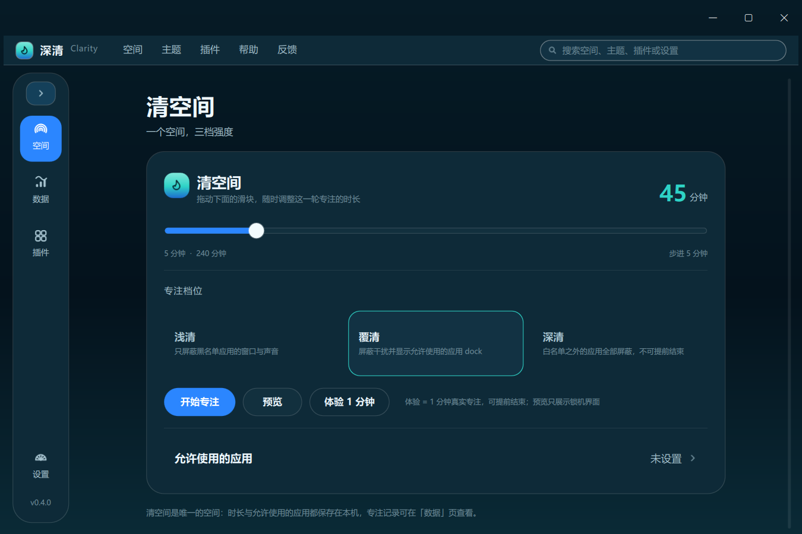
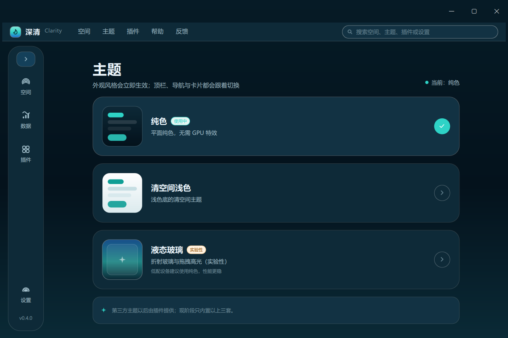
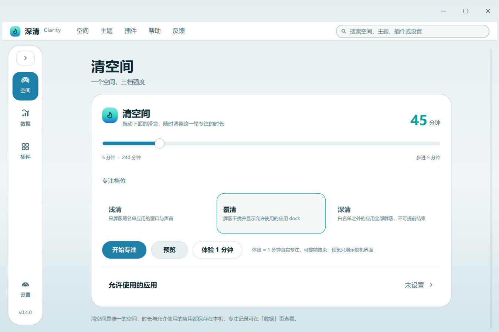
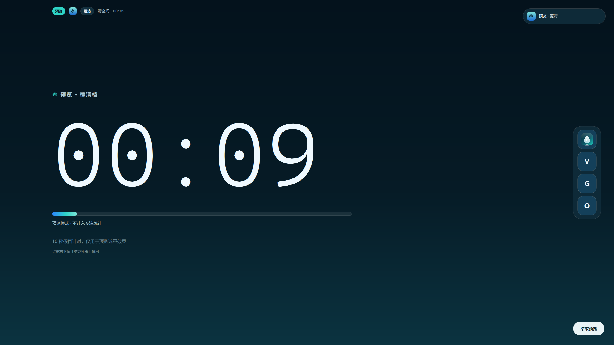

# 深清（Clarity）

Windows 平台的专注锁机工具：只有一个空间「**清空间**」，三档强度 **浅清 / 覆清 / 深清**；默认纯色主题，可切换清空间浅色与实验性液态玻璃。

## v0.6 变更

- **多空间**：浅清 / 覆清可新增多个空间（虚线「＋ 新增空间」卡），每张卡可就地改名、改时长（1–240 分钟）、删 ×、白名单；深清固定一个空间，不可增删改名，只能改时长与白名单。
- **空间页 = 三个界面**：顶部浏览器式标签 浅清 / 覆清 / 深清，下方两列卡片列表（名称 + 「N 分钟 >」+ 白色「开始」胶囊），参考禅定空间的列表卡片风格。
- **全局搜索**：窗口右上角搜索框在所有页面可用（Ctrl+K），支持空间 / 主题 / 模式 / 插件 / 设置。
- **保活**：独立看门狗进程每 2s 检查主进程，被杀后约 2 秒自动重新拉起（主动退出时看门狗自动结束）；新安装默认以最高权限运行并登记最高权限开机自启。
- 版本 0.6.0。

## v0.5 变更

- **三档空间**：浅清 / 覆清 / 深清 各一个空间卡片（两列网格）；浅清/覆清可改空间名，深清名固定、只能改锁定时间；每档独立时长与白名单。
- **空间页**：顶部横向三张模式卡切换视图；锁定时长滑块 **1–240 分钟**（最短 1 分钟即体验）；预览/体验按钮已移除。
- **导航分组**：上组 空间/数据/插件/主题，下组 设置/关于（贴底）；新增「关于」页（快捷键、使用说明、帮助反馈占位、许可与数据目录）。
- **深清档**：全屏遮罩只保留倒计时，不可提前结束。
- **液态玻璃高光**：高亮块比菜单项大一圈，长按可拖拽、松手吸附回弹。
- **反馈**：v0.5 暂不提供在线反馈（关于页占位），后续版本接入 GitHub/Gitee。
- 顶部全局菜单栏按反馈移除；搜索框移到空间页顶部。

## v0.4 有什么

- **清空间（唯一空间）**：不可改名/增删；就地设置专注时长（15–240 分钟，步进 5）与「允许使用的应用」。
- **三档强度**：浅清（屏蔽黑名单应用的窗口与声音）/ 覆清（额外显示允许应用的 dock）/ 深清（白名单外全部屏蔽，不可提前结束）。
- **顶部菜单栏 + 全局搜索**：空间 / 主题 / 插件 / 帮助 / 反馈；搜索空间、主题、插件与设置，回车打开第一项。
- **主题体系**：纯色（默认）/ 清空间浅色 / 液态玻璃（实验性）；玻璃主题下可**长按拖动导航高光**（放大 1.12、松手吸附并弹性回弹）。
- **预览模式**：只展示遮罩 10 秒假倒计时，不锁机、不写统计；**体验模式**：1 分钟真实专注，可提前结束，每小时最多 5 次。
- **覆清 dock**：专注时右半屏显示白名单应用图标，点击启动。
- **防退出加固**：锁定期间隐藏任务栏、屏蔽 Win/Alt+Tab 等系统快捷键，并每 500ms 重新置顶；结束后恢复。
- **权限**：以管理员身份运行（UAC 一次）、最高权限开机自启（计划任务 ONLOGON+HIGHEST）。
- **不杀进程**：默认隐藏窗口 + 静音（保留未保存工作），可切回直接结束进程。
- **插件**：目录即装、SDK/schema/模板/validate；插件可注册导航入口与全屏遮罩组件；内置「番茄同步」（番茄ToDo 数据互通，支持可选回写）与默认禁用的「CW2 全屏组件」。
- **国际化**：简体中文 + English（设置 → 语言），GitHub Actions 自动更新与编译翻译。

## 界面预览



| 主题页 | 浅色主题 |
| --- | --- |
|  |  |

| 液态玻璃拖拽高光 | 覆清 dock（预览） |
| --- | --- |
|  |  |

英文版：设置 → Language → English（截图 docs/images/en_main.png、en_settings.png）。

## 技术栈

| 项 | 选择 |
| --- | --- |
| 语言 | Python 3.13 |
| UI | PySide6 6.11 + QML（RinUI 0.4.4 提供窗口壳） |
| 主题 | 纯色 / 浅色 / 自研 LiquidGlass（ShaderEffectSource + GLSL，qsb 编译） |
| 媒体/通知 | Windows WinRT（SMTC、Toast + AUMID） |
| 音频屏蔽 | pycaw（Core Audio） |
| 平台 | Windows 10 10240+ / 11；PyInstaller onedir zip / 单文件 exe |

## 开发

```powershell
python -m pip install -r requirements.txt
python run.py
python -m unittest discover -s tests -v
python scripts/i18n.py extract / compile / check
```

冒烟（离屏）：`$env:QT_QPA_PLATFORM="offscreen"; $env:QT_QUICK_BACKEND="software"; python run.py --smoke`

打包：`powershell -ExecutionPolicy Bypass -File .\scripts\build_exe.ps1 -Mode onedir`

## 安装包与发布

本地已产出：

| 文件 | 说明 |
| --- | --- |
| `dist\installer\ShenQing-Setup-0.6.0.exe` | Inno Setup 安装包（安装到 Program Files、桌面/开始菜单快捷方式、可选最高权限开机自启） |
| `dist\ShenQing-Portable-v0.6.0.zip` | 绿色版（解压双击 `深清.exe` 即用） |

本地重新构建：

```powershell
python -m PyInstaller --noconfirm --clean packaging/ShenQing.spec
iscc /DAppVersion=0.6.0 packaging/installer.iss   # 需要 Inno Setup 6
Compress-Archive -Path "dist/深清/*" -DestinationPath "dist/ShenQing-Portable-v0.6.0.zip" -Force
```

**发布标签自动打包**：`.github/workflows/release.yml` 在推送 `v*` 标签时自动：
跑单测 + 冒烟 → PyInstaller 打包 → 生成绿色版 zip → choco 安装 Inno Setup 并生成安装包 → 作为附件发布到 GitHub Release（并自动生成 release notes）。
手动触发（Actions → Release → Run workflow）则把两个产物上传为 workflow artifacts，不发 release。

```bash
git tag v0.6.0 && git push origin v0.6.0
```

## 文档

- 功能规格（Obsidian）：`F:\obsidian_note\note\AI 程序创作清单\深清_功能规格.md`（v0.4）
- [开发说明](docs/开发说明.md)｜[插件开发](docs/插件开发.md)｜[国际化](docs/i18n.md)｜[SDK](sdk/README.md)
