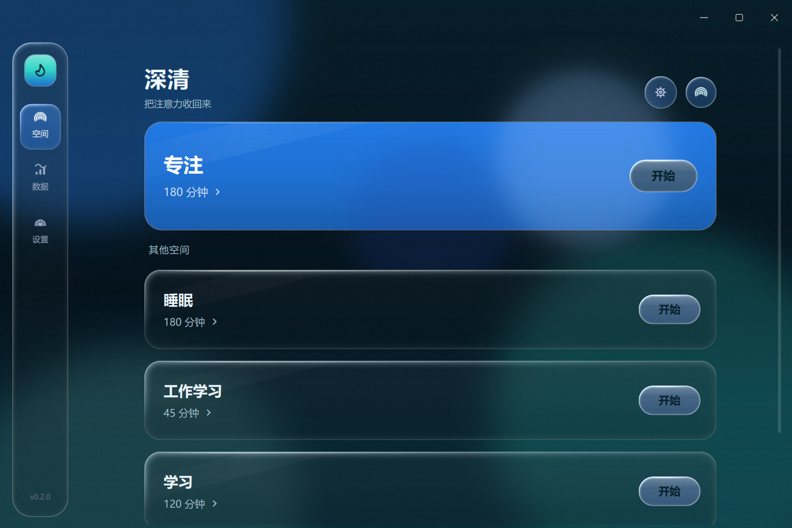
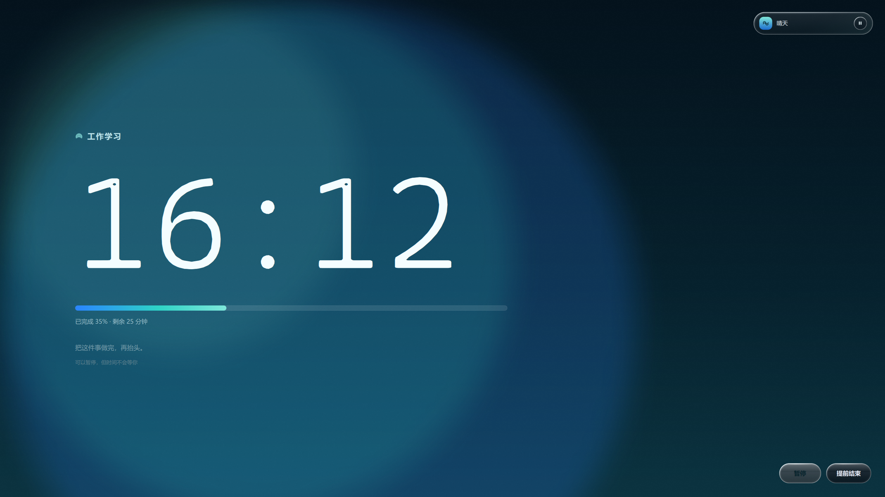
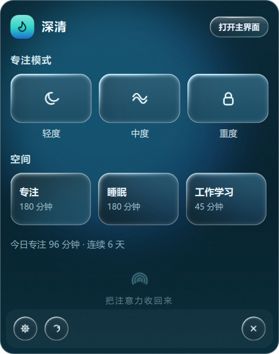
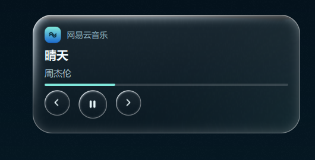
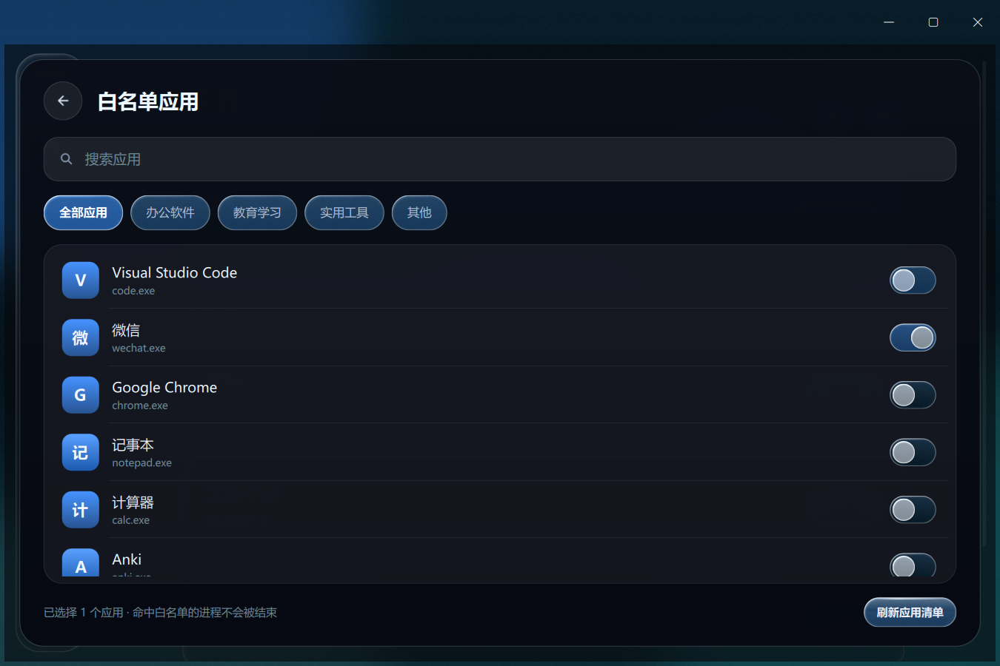
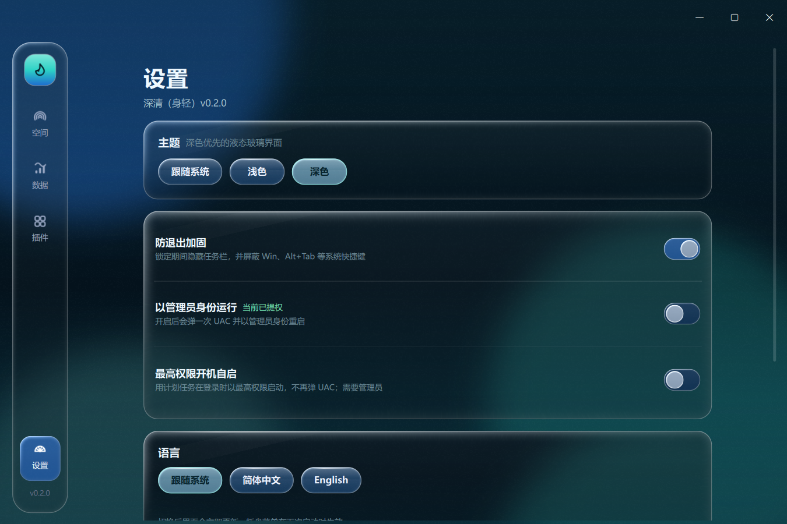
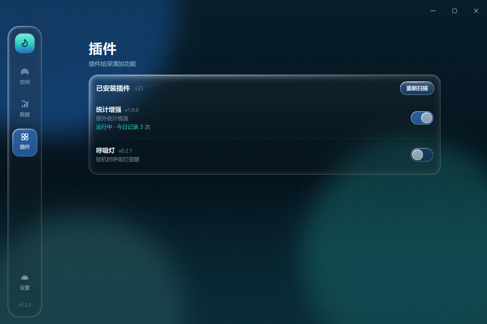
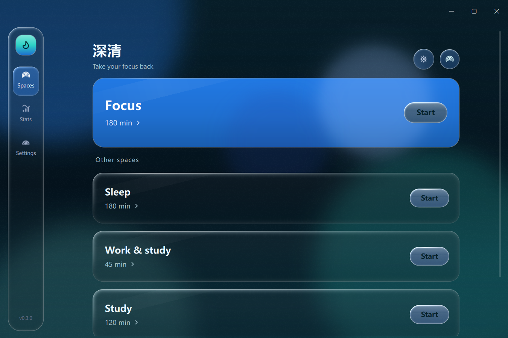
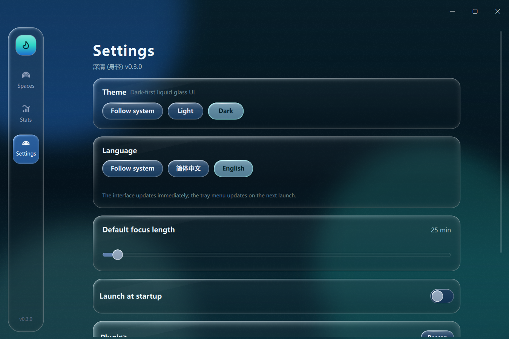

# 深清（ShenQing）

> 又名 **身轻**｜曾用名 ZenLock（禅锁）

Windows 平台的「专注锁机」桌面工具。开始专注后进入**全屏大海遮罩**（左侧倒计时、右上灵动岛），锁定期间按空间白名单放行应用、结束分心进程；界面是**海洋主题 + 液态玻璃**，插件体系参考 ClassWidgets 2。

## 现在能做什么（v0.3）

- **空间**：主空间（默认「专注」，固定重度强制）+「其他空间」分组；新增/编辑（名称、时长、氛围）/删除；点「开始」进入该空间的专注。
- **专注遮罩（所有强度默认全屏）**：左侧大号倒计时 + 空间名 + 水波进度 + 完成度；右上**灵动岛**；轻/中度允许暂停与提前结束，重度不显示且接口拒绝。
- **防退出加固**（开关，默认开）：锁定期间**隐藏任务栏（含副屏）**、用低级键盘钩子屏蔽 **Win / Alt+Tab / Alt+Esc / Ctrl+Esc / Alt+F4 / Ctrl+Shift+Esc**、每 500ms 重新置顶——解决「全屏盖不住任务栏」的问题；结束后自动恢复任务栏，并带退出/异常兜底恢复。
- **权限升级**：可开「以管理员身份运行」（UAC 一次后自动提权重启）与「最高权限开机自启」（计划任务 ONLOGON + HIGHEST，登录即高权限、不弹 UAC）。
- **灵动岛**：收起态显示媒体标题（或「专注中 · 剩余 mm:ss」）+ 播放/暂停；悬停展开显示应用/专辑、标题、艺术家、上一首/播放/下一首与进度条；无媒体时降级为空间名与完成度。
- **SMTC**：通过 Windows WinRT 读取系统媒体会话并控制播放（播放/暂停、上一首、下一首），1 秒轮询。
- **系统通知**：注册 AppUserModelID，专注结束/完成发 Windows Toast（进通知中心）；不可用时回退托盘气泡。
- **速启面板**：右键托盘图标弹出 CW2 风格的 375×475 玻璃面板——专注模式三档（轻度/中度/重度）一键开始、空间列表、今日统计、底部设置/刷新/退出；失焦自动收起。
- **导航**：空间 / 数据 / **插件**（独立页）/ 设置（固定在导航轨最底部）；首屏右上不再有齿轮/头像按钮。
- **白名单**：扫描本机开始菜单应用（真实图标 + 分类），开关式勾选；会话中命中白名单的进程不被结束。
- **统计**：今日/本周/连续天数/累计会话、近 7 天柱状图、CSV 导出。
- **液态玻璃**：卡片、按钮、开关、滑杆、导航高光全部 GLSL 折射玻璃；按钮**无 hover 动效**，按住不松手会朝鼠标方向**形变**、松手弹性回弹；导航高光是一个共享玻璃块，切换模块时连续滑动。
- **插件系统**：`%APPDATA%\ShenQing\plugins\<id>\` 目录即装；生命周期钩子 + PluginAPI（含 `set_ui_state` 状态上报）；内置 2 个示例；异常隔离。
- **首个真实插件「番茄同步」**：读取番茄ToDo 的本地数据（今日番茄数/分钟、连续天数、未完成待办），深清会话结束后并入插件历史；源码在 `F:\个人软件开发\深清插件开发`。
- **多语言（i18n）**：简体中文 + **English**，设置 → 语言可切换（含「跟随系统」）；Qt `.ts/.qm` 流程 + GitHub Actions 自动更新翻译源与编译产物（学 CW2 的 i18n-update 工作流）。

## 界面预览



| 全屏专注遮罩（轻度：可暂停/提前结束） | 托盘速启面板 |
| --- | --- |
|  |  |

| 灵动岛（展开） | 白名单应用 |
| --- | --- |
|  |  |

权限与防退出 / 插件页：

| 设置 · 权限与防退出 | 插件页 |
| --- | --- |
|  |  |

英文版（Settings → Language → English）：

| 主界面 | 设置页（语言卡） |
| --- | --- |
|  |  |

## 技术栈

| 项 | 选择 | 说明 |
| --- | --- | --- |
| 语言 | Python 3.10+（当前 3.13） | |
| UI | PySide6 6.11 + QML | LGPL，可闭源发布 |
| 组件库 | RinUI 0.4.4.1（MIT） | 窗口壳 / Text / ToolButton 等 |
| 玻璃 | 自研 `LiquidGlass`（ShaderEffectSource + GLSL，qsb 编译） | 见 [开发说明](docs/开发说明.md) |
| 媒体 | WinRT `winrt-Windows.Media.Control`（SMTC） | 1 秒轮询 + 播放控制 |
| 通知 | WinRT `Windows.UI.Notifications` + AUMID 注册 | 失败回退托盘气泡 |
| 平台 | Windows 10 10240+ / 11 | 发行：PyInstaller onedir zip / 单文件 exe |

## 目录结构

```
深清/
├─ run.py                  # 开发期入口
├─ requirements.txt
├─ pyproject.toml
├─ assets/                 # icon.png / icon.ico（海洋风：水滴 + 涟漪）
├─ docs/                   # 开发说明、契约、插件开发
├─ packaging/ShenQing.spec # PyInstaller 配置
├─ scripts/                # build_exe.ps1、make_icon.py
├─ tests/                  # 单元 + 集成测试（24 项）
└─ src/shenqing/
   ├─ app.py               # QApplication + 主窗口 + 托盘 + 速启面板定位
   ├─ bridge/              # QML <-> Python 的 App 桥（含媒体/通知/等级）
   ├─ core/                # 空间、会话、守护、统计、黑名单、应用清单
   ├─ plugins/             # 插件系统（api/manager/builtin）
   ├─ services/            # 托盘、开机自启、日志、SMTC、系统通知
   └─ qml/
      ├─ Main.qml          # 无边框窗口 + 导航轨 + 浮层 + 页面过渡
      ├─ QuickPanel.qml    # 托盘速启面板（CW2 TrayPanel 形态）
      ├─ glass/            # LiquidGlass + shaders（.frag/.vert/.qsb）
      ├─ components/       # GlassCard/Button/Switch/…/Glyph/Backdrop/MediaIsland/LockOverlay
      └─ pages/            # SpacesPage / SpaceSettingsSheet / WhitelistPage / PluginsPage / Stats / Settings
```

## 开发运行

```powershell
python -m pip install -r requirements.txt
python run.py
```

冒烟与测试：

```powershell
$env:QT_QPA_PLATFORM="offscreen"; $env:QT_QUICK_BACKEND="software"
python run.py --smoke          # 退出码 0 且 [smoke] QML 问题数：0
python -m unittest discover -s tests -v
```

## 打包

```powershell
powershell -ExecutionPolicy Bypass -File .\scripts\build_exe.ps1 -Mode onedir    # 绿色目录 + zip
powershell -ExecutionPolicy Bypass -File .\scripts\build_exe.ps1 -Mode onefile  # 单文件 exe
```

## 数据与文档

- 用户数据：`%APPDATA%\ShenQing\`（`settings.json` / `spaces.json` / `stats.json` / `apps.json` / `icons/` / `plugins/` / `logs/`）
- 功能规格（Obsidian）：`F:\obsidian_note\note\AI 程序创作清单\深清_功能规格.md`（v0.3，109 条验收）
- 开发：[开发说明](docs/开发说明.md)｜[接口契约](docs/契约_v0.2.md)｜[插件开发](docs/插件开发.md)｜[国际化](docs/i18n.md)
