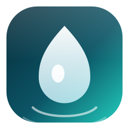
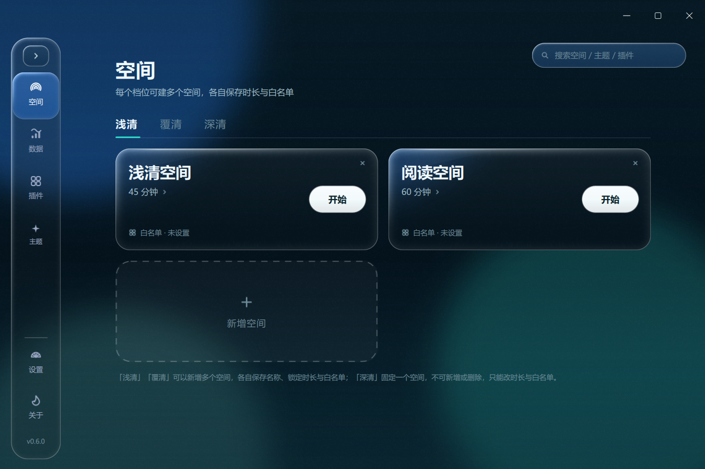
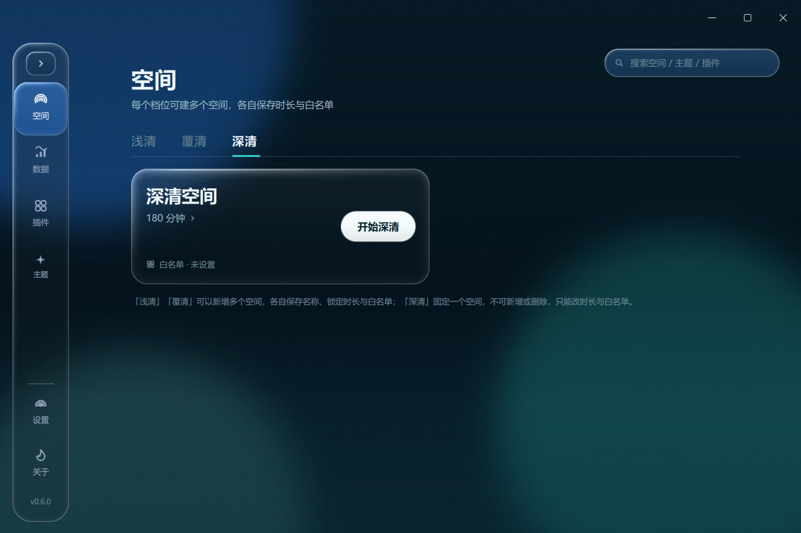
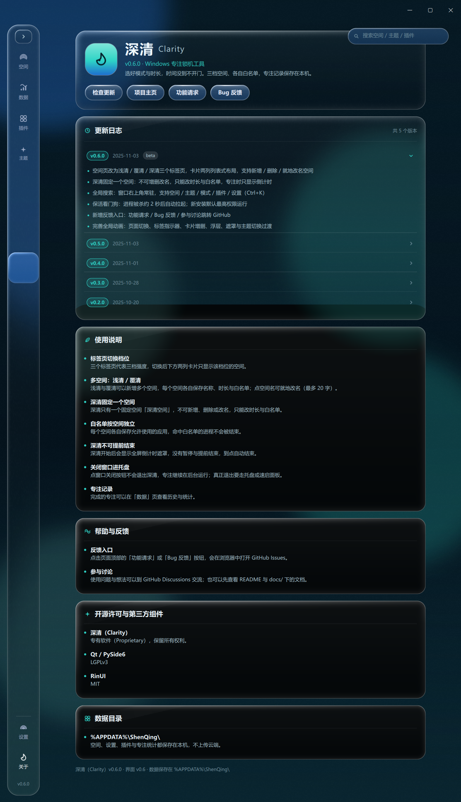
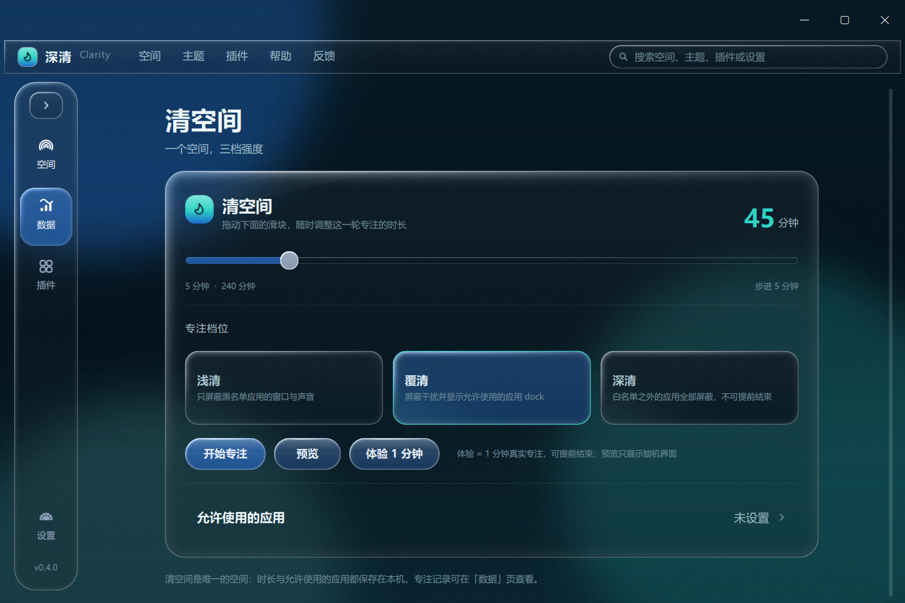

<div align="right">
<a href="/README.md">简体中文</a> | English
</div>

<p align="center">
  
</p>
<h1 align="center">
  ShenQing (Clarity)
</h1>
<p align="center">
  Finish this, then look up.
</p>

<div align="center">

[](https://github.com/Kryon2025/Clarity)
[](https://github.com/Kryon2025/Clarity/releases/latest)
[](https://github.com/Kryon2025/Clarity/releases)
[](../../LICENSE)
[](https://github.com/Kryon2025/Clarity/releases)
[](https://www.python.org/)

</div>

> [!TIP]
> ShenQing has a single space ("**Clarity Space**") with three intensity tiers: **Light / Veil / Deep**.
> Pick a duration and start focusing — the door stays shut until the timer runs out.



## Features

- **Three tiers**: Light (hides and mutes blacklisted apps) / Veil (plus a dock of allowed apps) / Deep (everything outside the allowlist blocked, no early exit, countdown only);
- **Multiple spaces**: Light and Veil can hold several spaces with their own name, duration and allowlist; Deep is a single fixed space where only the duration can change;
- **Browser-style tabs**: three tabs switch tiers, with a two-column card list below;
- **Full-screen focus overlay**: countdown, dynamic island (SMTC media), app dock on Veil;
- **Themes**: Solid (default) / Clarity Light / Liquid Glass (experimental);
- **Global search**: top-right on every page (Ctrl+K): spaces, themes, modes, plugins and settings;
- **Lock hardening**: hides the taskbar, blocks system shortcuts, re-asserts topmost during focus;
- **Keeper watchdog**: relaunches the app about 2s after the process is killed; elevated by default for new installs;
- **No force-kill**: hides windows and mutes audio instead, preserving unsaved work;
- **Plugin system**: drop-in plugins with nav entries and overlay widgets; built-in TomaToDo sync and a disabled-by-default CW2 widgets plugin;
- **i18n**: Simplified Chinese / English / Japanese / French, with automatic extraction and AI-assisted translation via GitHub Actions.

## Screenshots

| Spaces · Light | Deep · countdown only |
| --- | --- |
|  |  |

| About · changelog | Liquid glass drag highlight |
| --- | --- |
|  |  |

## Install & Usage

> [!IMPORTANT]
> Download the latest version from [**Releases**](https://github.com/Kryon2025/Clarity/releases).

- **Installer**: run `ShenQing-Setup-x.y.z.exe` (requests admin), creates desktop/start-menu shortcuts; optional elevated autostart;
- **Portable**: extract `ShenQing-Portable-vx.y.z.zip` and run `深清.exe`.

- Pick a tier and duration on the spaces page, then click the white "**Start**" pill;
- **Ctrl+K** opens global search; Deep cannot be ended early;
- Closing the window only hides it to the tray; quit from the tray menu or quick panel;
- Data lives in `%APPDATA%\ShenQing\` and never leaves your machine;
- License: [LICENSE](../../LICENSE) (GPL-3.0); third-party notices and resources: [NOTICE](../../NOTICE).

## Changelog

See [CHANGELOG.md](../../CHANGELOG.md) (also available in the in-app About page).

## Development

```powershell
python -m pip install -r requirements.txt
python run.py                              # run from source
python -m unittest discover -s tests -v    # tests
$env:QT_QPA_PLATFORM="offscreen"; $env:QT_QUICK_BACKEND="software"; python run.py --smoke
python scripts/i18n.py extract             # compile / check likewise
```

Build:

```powershell
python -m PyInstaller --noconfirm --clean packaging/ShenQing.spec
iscc /DAppVersion=0.6.0 packaging/installer.iss   # needs Inno Setup 6
Compress-Archive -Path "dist/深清/*" -DestinationPath "dist/ShenQing-Portable-v0.6.0.zip" -Force
```

Pushing a `v*` tag runs [release.yml](../../.github/workflows/release.yml), which tests, packages the portable zip and installer, and publishes the changelog as the release body and assets.

## Plugins

- SDK: [sdk/README.md](../../sdk/README.md), manifest schema: [sdk/plugin.schema.json](../../sdk/plugin.schema.json)
- Docs: [docs/插件开发.md](../../docs/插件开发.md)
- Templates: [`templates/basic-plugin`](../../templates/basic-plugin), [`templates/widget-plugin`](../../templates/widget-plugin)
- Validate: `python -m shenqing.plugins.validate <plugin-dir>`
- Install: drop the plugin folder/zip into `%APPDATA%\ShenQing\plugins\` and rescan on the Plugins page.

## Feedback & Contributing

- Bugs / feature requests: [Issues](https://github.com/Kryon2025/Clarity/issues)
- Discussions: [Discussions](https://github.com/Kryon2025/Clarity/discussions)
- PRs are welcome; please make sure tests and smoke pass.

## License

ShenQing (Clarity) is released under the **GNU General Public License v3.0 (GPL-3.0-only)**. See [LICENSE](../../LICENSE).
Third-party components, resources and design references are listed in [NOTICE](../../NOTICE).

Copyright © 2025 Kryon.

## Acknowledgements

- [Qt](https://www.qt.io/) / [PySide6](https://doc.qt.io/qtforpython/) (LGPLv3)
- [RinUI](https://github.com/RinLit-233-shiroko/RinUI) (MIT)
- [pywin32](https://github.com/mhammond/pywin32) (PSF-2.0)
- [pycaw](https://github.com/AndreMiras/pycaw) (MIT)
- [PyInstaller](https://pyinstaller.org/) and [Inno Setup](https://jrsoftware.org/isinfo.php)
- Space card and About page interactions inspired by [Class Widgets 2](https://github.com/RinLit-233-shiroko/Class-Widgets-2)
